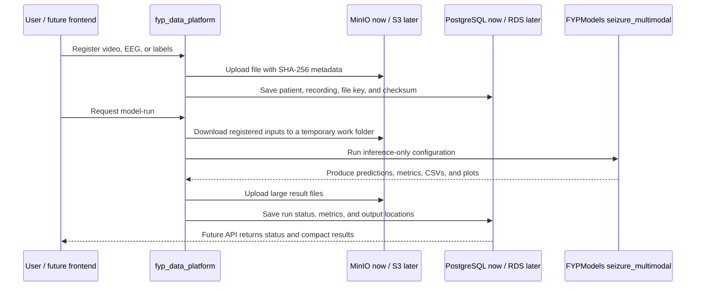
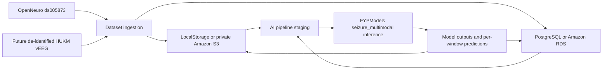
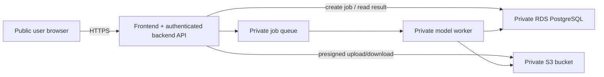

# FYP Data Platform

This is the storage, metadata, and orchestration project for **Automated Video
Analysis in Temporal Lobe Epileptic Seizures Using Multimodal Deep Learning**.
The data platform owns object storage, PostgreSQL, ingestion, and pipeline
staging. The authoritative inference pipeline is
`../FYPModels/seizure_multimodal`. `BodyPose/body_pose_fyp` is legacy
and is retained only for historical compatibility and its SeizeIT2 annotation
adapter.

This is a research prototype, not a clinical system or medical device. The
current development source is public OpenNeuro `ds005873` (SeizeIT2). Future HUKM
video and scalp EEG require governance, de-identification, and a confirmed data
contract before ingestion is implemented.

## What this project does in simple terms

This project is the bridge between the website, the model, and the data. It
does not contain the trained model and it is not yet a web API.

- **MinIO** stores large files locally: videos, EEG files, label workbooks,
  checkpoints, plots, CSV results, and other model outputs.
- **PostgreSQL** stores searchable information about those files: dataset,
  patient and recording IDs, labels, checksums, processing status, model runs,
  metrics, and predictions.
- **`FYPModels`** is the authoritative AI workspace. The platform
  temporarily downloads the required inputs, runs `seizure_multimodal`, uploads
  its outputs, and records the run in PostgreSQL.
- **The frontend** will eventually call a backend API to upload files, start
  processing, and read results. That API connection is not implemented yet.
- **BodyPose** is legacy. Its files and compatibility command remain, but it is
  not the active model pipeline.

The actual video is never stored inside PostgreSQL. PostgreSQL stores a MinIO/S3
key such as `datasets/study/source/manual/patient-001/recording-001/video.mp4`.
The same key continues to work when MinIO is replaced with Amazon S3.

## Current end-to-end flow



Current local addresses:

| Component | Address | Purpose |
|---|---|---|
| MinIO API | `http://localhost:9000` | Application object-storage endpoint |
| MinIO console | `http://localhost:9001` | Browser for inspecting local objects |
| PostgreSQL | `localhost:5432` | Metadata and processing catalog |
| Model | `../FYPModels` | Local inference code and checkpoints |

Credentials are stored only in the gitignored `.env` file. Never commit it.

## First-time setup on a group member's computer

Requirements:

- Windows 10/11 with WSL2 virtualization available;
- Docker Desktop, free for educational use;
- Python 3.10-3.12;
- this repository with the `FYPModels` workspace;
- sufficient disk space for Docker images, model checkpoints, and test files;
- an NVIDIA/CUDA-compatible model environment if GPU inference is required.

From `fyp_data_platform` in PowerShell:

```powershell
# 1. Create local secrets/configuration. This file is ignored by Git.
Copy-Item .env.example .env

# 2. Edit .env. Replace DB_PASSWORD in both DB_PASSWORD and DATABASE_URL.
# Set one custom MinIO username/password pair in both MINIO_ROOT_* and
# AWS_ACCESS_KEY_ID/AWS_SECRET_ACCESS_KEY.

# 3. Create a clean Python environment.
python -m venv .venv312
.\.venv312\Scripts\Activate.ps1
python -m pip install --upgrade pip
python -m pip install -e ".[dev]"

# 4. Build and start PostgreSQL and MinIO.
docker compose up -d --build

# 5. Create/update the PostgreSQL tables.
python -m fyp_data_platform --config configs/docker.example.yaml db-upgrade

# 6. Verify the installation.
docker compose ps -a
docker compose logs s3-init
python -m fyp_data_platform --config configs/docker.example.yaml catalog-summary
python -m pytest
```

Expected state:

- `postgres` and `minio` show `healthy`;
- `s3-init` shows `Exited (0)` after creating the private `fyp-local` bucket;
- tests pass;
- the MinIO console opens at `http://localhost:9001`.

The first MinIO build compiles the archived AGPLv3 community source and can take
several minutes. Later starts reuse the built image.

## How to run it day to day

Start Docker Desktop, open PowerShell in `fyp_data_platform`, then run:

```powershell
.\.venv312\Scripts\Activate.ps1
docker compose up -d
docker compose ps -a
```

Useful commands:

```powershell
# Show catalog counts.
python -m fyp_data_platform --config configs/docker.example.yaml catalog-summary

# See all available platform commands.
python -m fyp_data_platform --help

# Follow service logs.
docker compose logs -f postgres minio

# Stop containers but keep all data.
docker compose stop

# Restart stopped containers.
docker compose start

# Remove containers/network but keep the named data volumes.
docker compose down
```

Do **not** run `docker compose down -v` unless you intentionally want to delete
the local PostgreSQL database and every MinIO object.

### Register inputs and run the model

The terminal workflow supports two video modes:

- **Prediction-only deployment mode:** register an MP4 and run `model-run`.
  The model saves timestamped probabilities, predictions, plots, embeddings,
  and `metrics.json` with accuracy fields marked `N/A` because no ground truth
  label was supplied.
- **Development/evaluation mode:** register the MP4 and a matching label
  workbook under the same dataset, patient, and recording IDs, then run
  `model-run --require-labels`. The model compares prediction windows with the
  label timestamps and stores accuracy-style metrics.

Register a video for prediction-only mode:

```powershell
python -m fyp_data_platform --config configs/docker.example.yaml register-media `
  --file C:\path\recording.mp4 `
  --dataset-id development `
  --dataset-name "Development recordings" `
  --patient-id synthetic-001 `
  --recording-id recording-001 `
  --modality video
```

Run video prediction-only mode:

```powershell
python -m fyp_data_platform --config configs/docker.example.yaml model-run `
  --dataset-id development `
  --recording-id recording-001 `
  --mode video
```

For development/evaluation mode, register the matching label workbook after the
video:

```powershell
python -m fyp_data_platform --config configs/docker.example.yaml register-media `
  --file C:\path\Label.xlsx `
  --dataset-id development `
  --dataset-name "Development recordings" `
  --patient-id synthetic-001 `
  --recording-id recording-001 `
  --modality labels
```

```powershell
python -m fyp_data_platform --config configs/docker.example.yaml model-run `
  --dataset-id development `
  --recording-id recording-001 `
  --mode video `
  --require-labels
```

The model command runs synchronously in the terminal. Do not close the terminal
while inference is running. Outputs are uploaded below
`datasets/<dataset>/derived/<recording>/model-runs/<run-id>/`, while run status
and metrics are recorded in PostgreSQL. Training remains disabled.

### Troubleshooting checks

```powershell
docker compose ps -a
docker compose logs --tail 100 postgres minio s3-init
python -m fyp_data_platform --config configs/docker.example.yaml catalog-summary
```

- If `docker` is not recognized immediately after installation, reopen the
  terminal or restart Codex so it receives the updated `PATH`.
- If port `5432`, `9000`, or `9001` is occupied, change the corresponding port
  in `.env`.
- Do not leave `AWS_PROFILE=` blank in `.env`; omit it for MinIO or set a real
  profile name for AWS.
- Local MinIO uses `S3_SERVER_SIDE_ENCRYPTION=` because no external KMS is
  configured. The AWS configuration enables `AES256`.

## Architecture



Large payloads and artifacts stay in object storage. PostgreSQL contains IDs,
timestamps, canonical annotations, deterministic temporal-window metadata,
storage keys, checksums, model-run metadata, and compact predictions. It never
stores videos, EDFs, embedding matrices, or checkpoints as BLOB/BYTEA values.

The implemented logical object keys are intentionally shallow:

```text
datasets/<dataset-id>/source/<BIDS-or-manual-relative-path>
datasets/<dataset-id>/derived/<recording-id>/pose/<artifact>
datasets/<dataset-id>/derived/<recording-id>/features/<artifact>
```

An optional `S3_PREFIX` can place the entire tree below a deployment prefix.
Future face, motion, windows, embeddings, models, and results use the same
`derived` convention without schema changes.

## Project layout

```text
fyp_data_platform/
|-- configs/                  example local, AWS, and dataset manifests
|-- fyp_data_platform/
|   |-- config/              environment/YAML settings
|   |-- db/                  SQLAlchemy models, sessions, repositories
|   |-- ingest/              BIDS discovery, SeizeIT2 service, HUKM boundary
|   |-- integrations/        authoritative model staging/run/registration
|   |-- storage/             common LocalStorage and S3Storage contract
|   `-- ui.py                simple local browser UI for uploads and video runs
|-- migrations/              Alembic migration history
|-- tests/                   synthetic BIDS, storage, migration, idempotence tests
|-- docker/                  reproducible local service images
|-- docker-compose.yml       local PostgreSQL 16 and MinIO
|-- .env.example
|-- alembic.ini
`-- pyproject.toml
```

## Local setup

Python 3.10-3.12 and Docker Desktop are recommended. From this directory:

```powershell
Copy-Item .env.example .env
python -m venv .venv
.\.venv\Scripts\Activate.ps1
python -m pip install --upgrade pip
python -m pip install -e ".[dev]"
docker compose up -d postgres
python -m fyp_data_platform --config configs/local.example.yaml db-upgrade
```

For filesystem-only storage, set `FYP_STORAGE_BACKEND=local` in the untracked
`.env` file. Change `DB_PASSWORD` and the matching password in `DATABASE_URL`.
YAML contains only safe examples; environment variables take precedence.
`data/` is the local object-store equivalent and is gitignored.

If Docker is unavailable, point `DATABASE_URL` at an existing PostgreSQL 14+
database. SQLite is used only by automated tests, not as the intended runtime
catalog.

## Fully local Docker storage

For development without an AWS account, `docker-compose.yml` runs persistent
PostgreSQL and MinIO services. The one-shot `s3-init` service creates a private
`fyp-local` bucket automatically. No cloud account, real AWS credentials, or
payment method is used.

MinIO Community stopped distributing maintained binaries in 2026. To avoid the
newer commercial/evaluation binary terms, this project builds the final
security-fixed community release (`RELEASE.2025-10-15T17-29-55Z`) directly from
its AGPLv3 source. Review AGPLv3 obligations before redistributing a built image
or modifying MinIO itself. The source project is archived, so this local stack
is suitable for development and research prototyping, not public production.

```powershell
Copy-Item .env.example .env
# Edit .env: replace DB_PASSWORD in both places, then set the same custom
# MinIO username/password in MINIO_ROOT_* and AWS_ACCESS_KEY_ID/SECRET_ACCESS_KEY.
docker compose up -d --build
python -m fyp_data_platform --config configs/docker.example.yaml db-upgrade
python -m fyp_data_platform --config configs/docker.example.yaml catalog-summary
```

Confirm that all services started and that bucket initialization completed:

```powershell
docker compose ps -a
docker compose logs s3-init
```

Open the MinIO object browser at `http://localhost:9001`. Use `register-media`
with a small non-clinical video to exercise a real upload through the
application. PostgreSQL and objects persist in the `fyp_postgres_data` and
`fyp_minio_data` Docker volumes. `docker compose down` keeps both volumes;
`docker compose down -v` permanently deletes them.

The local config sets `S3_ENDPOINT_URL=http://localhost:9000` and reuses the
local MinIO username/password as SDK credentials. Real AWS leaves the endpoint
unset and uses an SSO profile or IAM role, so the storage implementation and
object keys do not change when moving to AWS.

## Local browser UI

The local UI is a small Flask app inside this platform package. It is not the
old Laravel prototype in `../frontend`. Dragging an MP4 into the page uploads
the video into MinIO and writes the dataset, patient, recording, and file rows
into PostgreSQL. Pressing **Run** starts the same video-only model workflow as
the terminal `model-run` command.

The UI currently supports prediction-only video runs. Label upload/evaluation
mode is still available through the terminal commands below.

### Mac setup and run

From `fyp_data_platform`:

```bash
cp .env.example .env
python3 -m venv .venv
source .venv/bin/activate
python -m pip install --upgrade pip
python -m pip install -e ".[dev,ui]"
python -m pip install -e "../FYPModels[video]"
docker compose up -d --build
python -m fyp_data_platform --config configs/docker.example.yaml db-upgrade
python -m fyp_data_platform --config configs/docker.example.yaml ui --host 127.0.0.1 --port 8080
```

Open `http://127.0.0.1:8080`.

Daily Mac run after setup:

```bash
cd "/Users/lychee/Documents/Y3S2_FIT3162_FYP/MDS10-FYP/fyp_data_platform"
source .venv/bin/activate
docker compose up -d
python -m fyp_data_platform --config configs/docker.example.yaml ui --host 127.0.0.1 --port 8080
```

### Windows setup and run

Use PowerShell from `fyp_data_platform`:

```powershell
Copy-Item .env.example .env
py -3.12 -m venv .venv
.\.venv\Scripts\Activate.ps1
python -m pip install --upgrade pip
python -m pip install -e ".[dev,ui]"
python -m pip install -e "..\FYPModels[video]"
docker compose up -d --build
python -m fyp_data_platform --config configs/docker.example.yaml db-upgrade
python -m fyp_data_platform --config configs/docker.example.yaml ui --host 127.0.0.1 --port 8080
```

Open `http://127.0.0.1:8080`.

Daily Windows run after setup:

```powershell
cd "C:\path\to\MDS10-FYP\fyp_data_platform"
.\.venv\Scripts\Activate.ps1
docker compose up -d
python -m fyp_data_platform --config configs/docker.example.yaml ui --host 127.0.0.1 --port 8080
```

MinIO is still available at `http://localhost:9001` with the credentials in
`.env`, and PostgreSQL remains at `localhost:5432`.

## SeizeIT2 development workflow

No pre-existing persistent `ds005873` checkout was found during implementation;
a gitignored sparse v1.1.0 checkout was used only for verification. Point the
commands at your own checkout when one is available. A normal Git/DataLad checkout may
contain a mix of ordinary JSON/TSV metadata and git-annex links for large EDF
payloads. The inspector checks broken symlinks and small annex/LFS pointer files;
metadata-only ingestion registers unavailable EDF references without opening,
hashing, or copying them.

Inspect only:

```powershell
python -m fyp_data_platform inspect-bids `
  --dataset-path ..\ds005873 `
  --subjects sub-001 sub-002 sub-003
```

Plan without writing objects or database rows:

```powershell
python -m fyp_data_platform --config configs/local.example.yaml ingest-seizeit2 `
  --dataset-path ..\ds005873 `
  --subjects sub-001 sub-002 sub-003 `
  --metadata-only `
  --dry-run
```

Ingest the same small subset in safe metadata-only mode (the default when no
payload flag is supplied):

```powershell
python -m fyp_data_platform --config configs/local.example.yaml ingest-seizeit2 `
  --dataset-path ..\ds005873 `
  --subjects sub-001 sub-002 sub-003 `
  --metadata-only
```

Use `--sessions ses-01 ses-02` for another subset dimension. Only an explicit
`--include-edf` stores materialized EDF files; only `--include-video` stores
video. `--metadata-only` cannot be combined with either payload flag. No
ECG/EMG/movement stream is used by the AI project, and wearable signals are not
treated as video motion or future clinical scalp EEG.

Subject/session filters limit subject directories and catalog entities. Small
root-level BIDS documents such as `dataset_description.json`, `events.json`, and
the public `participants.tsv` are retained once as dataset-level provenance.

The ingestion service delegates annotation parsing to
`BodyPose/body_pose_fyp/body_pose/annotation_interface.py`. Its existing mapping
is therefore authoritative: `sz* -> ictal`, explicit `bckg -> normal`, and
unknown/`impd` events are excluded. No `pre_ictal` interval is invented.

## Idempotence and integrity

Database uniqueness is enforced for dataset-scoped patient and recording IDs,
source paths, annotation identities, deterministic `window_id` values, and
model-run/window predictions. Repository upserts make the second ingestion
update the existing catalog rather than duplicate it.

Every materialized file is SHA-256 hashed once by ingestion. Local writes use a
verified partial file and atomic rename. S3 writes store SHA-256 in object
metadata and compare `HEAD` metadata before deciding to upload; downloads verify
size and checksum. Unmaterialized annex pointers have no invented checksum.

## Inspecting PostgreSQL

The built-in summary avoids requiring a database GUI:

```powershell
python -m fyp_data_platform --config configs/local.example.yaml catalog-summary
```

Or inspect with `psql` inside the Compose container:

```powershell
docker compose exec postgres psql -U fyp_user -d fyp_data -c "SELECT * FROM datasets;"
docker compose exec postgres psql -U fyp_user -d fyp_data -c "SELECT * FROM patients;"
docker compose exec postgres psql -U fyp_user -d fyp_data -c "SELECT * FROM recordings;"
docker compose exec postgres psql -U fyp_user -d fyp_data -c "SELECT * FROM annotations LIMIT 20;"
docker compose exec postgres psql -U fyp_user -d fyp_data -c "SELECT COUNT(*) FROM annotations WHERE label = 'ictal';"
```

Apply future schema changes only through Alembic:

```powershell
python -m fyp_data_platform --config configs/local.example.yaml db-upgrade
```

## Authoritative model integration

The platform's `model-run` command stages registered inputs from the configured
storage backend, generates an inference-only configuration, invokes
`FYPModels/seizure_multimodal`, uploads its result tree, and records
the run status, configuration, metrics, and output objects in PostgreSQL.

The configured EEG checkpoint is the Keras full-model artifact:
`../FYPModels/checkpoints/pretrained/eeg/seizure_detector_model.keras`.

### Fresh start terminal run

From `fyp_data_platform`, run this once on a fresh machine. Edit `.env` before
starting Docker so `DB_PASSWORD`, `DATABASE_URL`, `MINIO_ROOT_*`, and
`AWS_ACCESS_KEY_ID/AWS_SECRET_ACCESS_KEY` agree.

```powershell
Copy-Item .env.example .env
python -m venv .venv312
.\.venv312\Scripts\Activate.ps1
python -m pip install --upgrade pip
python -m pip install -e ".[dev]"
docker compose up -d --build
python -m fyp_data_platform --config configs/docker.example.yaml db-upgrade
python -m fyp_data_platform --config configs/docker.example.yaml catalog-summary
```

### Daily terminal run

Use this after the first setup:

```powershell
.\.venv312\Scripts\Activate.ps1
docker compose up -d
docker compose ps -a
python -m fyp_data_platform --config configs/docker.example.yaml catalog-summary
```

### Prediction-only video mode

Use this when you only have MP4s and want timestamped model predictions stored
in MinIO/PostgreSQL. Pick one MP4 from your folder and give it stable IDs:

```powershell
python -m fyp_data_platform --config configs/docker.example.yaml register-media `
  --file C:\path\mp4-folder\recording-001.mp4 `
  --dataset-id deployment-videos `
  --dataset-name "Deployment video predictions" `
  --patient-id patient-001 `
  --recording-id recording-001 `
  --modality video
```

```powershell
python -m fyp_data_platform --config configs/docker.example.yaml register-media `
  --file C:\path\mp4-folder\recording-002.mp4 `
  --dataset-id deployment-videos `
  --dataset-name "Deployment video predictions" `
  --patient-id patient-002 `
  --recording-id recording-002 `
  --modality video
```

Run one registered video:

```powershell
python -m fyp_data_platform --config configs/docker.example.yaml model-run `
  --dataset-id deployment-videos `
  --recording-id recording-001 `
  --mode video
```

Prediction-only outputs include `video_only/predictions.csv`,
`video_only/probability_timeline.csv`, `video_only/timeline.png`,
`video_only/embeddings.npy`, and `video_only/metrics.json`. Accuracy fields are
`N/A` until a human label file is supplied later.

### Development/evaluation video mode

Use this when you have the matching `Label.xlsx` and want the run to fail early
if labels are missing:

```powershell
python -m fyp_data_platform --config configs/docker.example.yaml register-media `
  --file C:\path\mp4-folder\recording-001.mp4 `
  --dataset-id development `
  --dataset-name "Development evaluation recordings" `
  --patient-id patient-001 `
  --recording-id recording-001 `
  --modality video
```

```powershell
python -m fyp_data_platform --config configs/docker.example.yaml register-media `
  --file C:\path\labels\Label.xlsx `
  --dataset-id development `
  --dataset-name "Development evaluation recordings" `
  --patient-id patient-001 `
  --recording-id recording-001 `
  --modality labels
```

```powershell
python -m fyp_data_platform --config configs/docker.example.yaml model-run `
  --dataset-id development `
  --recording-id recording-001 `
  --mode video `
  --require-labels
```

If labels are registered but `--require-labels` is omitted, the run still uses
the label workbook when available. The flag is useful for development because it
prevents accidentally running a prediction-only job when you expected accuracy
metrics.

Use `--cleanup` only after outputs have been uploaded successfully. Managed
simulated multimodal runs are intentionally unavailable because their unrelated
data cannot be interpreted clinically. Training remains disabled.

## Legacy BodyPose integration

This compatibility path is no longer the active model. The BodyPose project
still works entirely with ordinary local paths. For the
managed workflow, this platform resolves a registered video, downloads it to a
per-recording work directory, invokes the existing explicit-input pose and
feature CLIs, uploads outputs, and registers each derived artifact in the
`files` table.

For a non-clinical infrastructure test, first register one existing sample:

```powershell
python -m fyp_data_platform --config configs/local.example.yaml register-media `
  --file ..\BodyPose\body_pose_fyp\videos\UpperBodyNormal.mp4 `
  --dataset-id development-samples `
  --dataset-name "Non-clinical development samples" `
  --patient-id synthetic-001 `
  --recording-id upper-body-normal `
  --modality video
```

```powershell
python -m fyp_data_platform --config configs/local.example.yaml body-run `
  --dataset-id development-samples `
  --recording-id upper-body-normal
```

Add `--cleanup` to remove only that run's staging directory after all uploads
and database registration succeed. The sample is an infrastructure test and
must not be interpreted as seizure data. Body embeddings/windows are left to
the existing BodyPose build/train/export workflow; adding those orchestration
steps later should preserve its exact `window_id` contract.

## Future migration to hosted Amazon S3

Moving to AWS changes the infrastructure and credentials, not the Python
storage interface or logical object keys:

```text
Local development                         Hosted deployment
-----------------                         -----------------
MinIO :9000             ------------->    private Amazon S3 bucket
PostgreSQL container    ------------->    private RDS PostgreSQL
local model process     ------------->    GPU/CPU worker (EC2/ECS/approved service)
CLI commands            ------------->    backend API + background job queue
Laravel frontend        ------------->    public HTTPS web application
```

AWS is not free in the same sense as the local stack. An approved AWS account,
billing method or school-managed billing account, budget alerts, and responsible
account owner are required before resources are created. No AWS resource has
been created by this repository.

### Hosting requirements

Before calling the system publicly hosted, the project still needs:

1. **Private S3:** Block Public Access enabled, encryption enabled, versioning
   and lifecycle/retention rules agreed, and no public object ACLs.
2. **Private PostgreSQL/RDS:** encrypted storage and backups, TLS required, and
   network access limited to the backend/worker security group—not the internet.
3. **Backend API:** authenticated endpoints for uploads, job creation, job
   status, and results. The current project provides CLI/services, not this API.
4. **Background worker:** inference should run outside the web request. A queue
   and worker need retry, timeout, failure, and idempotency policies.
5. **Model compute:** an approved CPU/GPU host with the exact FYPModels runtime,
   checkpoints, CUDA version where applicable, and enough temporary disk.
6. **Authentication/authorization:** users must only access permitted datasets
   and recordings. The Laravel frontend must call the API rather than S3 or RDS
   directly.
7. **Secrets management:** use IAM roles and a managed secret store; never put
   access keys or database passwords in Git, frontend JavaScript, Docker images,
   or committed YAML.
8. **HTTPS and networking:** public DNS and TLS termination for the frontend/API;
   private subnets or equivalent controls for RDS and workers.
9. **Observability and recovery:** central logs, job audit history, alarms,
   backups, restore testing, and cost/budget alerts.
10. **Clinical/research governance:** school and hospital approval,
    de-identification, consent/data-use conditions, retention/deletion rules,
    incident response, and an access review before any HUKM data is uploaded.

The safe public architecture is therefore:



Do not make the S3 bucket public. If a user needs to upload or view a file, the
backend should authorize the request and issue a short-lived presigned URL.

### Configuration changes for AWS

Local MinIO configuration:

```text
FYP_STORAGE_BACKEND=s3
S3_ENDPOINT_URL=http://localhost:9000
S3_BUCKET=fyp-local
AWS_ACCESS_KEY_ID=<local MinIO user>
AWS_SECRET_ACCESS_KEY=<local MinIO password>
S3_SERVER_SIDE_ENCRYPTION=
DATABASE_URL=postgresql+psycopg://...@localhost:5432/fyp_data
```

Hosted AWS configuration:

```text
FYP_ENVIRONMENT=aws
FYP_STORAGE_BACKEND=s3
S3_ENDPOINT_URL=                 # unset: boto3 uses the real AWS endpoint
S3_BUCKET=<approved-private-bucket>
S3_PREFIX=<environment-prefix>
AWS_REGION=ap-southeast-1
S3_SERVER_SIDE_ENCRYPTION=AES256 # or aws:kms with S3_KMS_KEY_ID
DATABASE_URL=postgresql+psycopg://<user>:<secret>@<private-rds>:5432/<db>?sslmode=require
```

On AWS-hosted compute, omit `AWS_ACCESS_KEY_ID`, `AWS_SECRET_ACCESS_KEY`, and
`AWS_PROFILE`; attach a least-privilege IAM role instead. For approved local
administration, use AWS SSO and an `AWS_PROFILE`.

### Data migration procedure

Test this procedure first with synthetic/non-clinical data:

1. Create the private S3 bucket, RDS database, IAM role, networking, encryption,
   backups, lifecycle rules, logging, and budget alerts.
2. Apply Alembic migrations to empty RDS using `configs/aws.example.yaml`.
3. Copy MinIO objects to the same `S3_PREFIX` in S3 using an approved migration
   tool such as `mc mirror` or `aws s3 sync`; preserve object paths and metadata.
4. Export local PostgreSQL with `pg_dump` and restore it into RDS using
   `pg_restore`, or use an approved managed migration service.
5. Run `storage-check` against several known object keys and compare SHA-256
   metadata, sizes, catalog counts, and model-run relationships.
6. Run one end-to-end synthetic recording through the hosted worker.
7. Obtain security/governance approval before migrating real clinical data.
8. Keep the local copy until the migration, backup, and restore checks are
   signed off; then follow the approved retention/deletion policy.

### AWS mode reference configuration

No AWS resource is provisioned and no data has been uploaded by this project.
Before enabling AWS mode:

1. Create or obtain an existing private S3 bucket in the chosen region. Enable
   Block Public Access, encryption, versioning where appropriate, and a lifecycle
   policy for temporary/derived objects.
2. Grant the execution identity only `ListBucket` on the configured prefix and
   `GetObject`, `PutObject`, and (only if cleanup is required) `DeleteObject`
   below that prefix. Do not grant public ACL permissions.
3. Authenticate locally with an AWS CLI profile/SSO, or use an IAM role on AWS.
   Never put access keys in YAML, source code, or Git.
4. Create/obtain a private RDS for PostgreSQL instance, limit its security group
   to the compute/client network, enable encrypted storage/backups, and require
   TLS. Store the password in a secret store or untracked environment variable.
5. Copy `configs/aws.example.yaml` to an untracked local config and set
   `S3_BUCKET`, `AWS_REGION`, optional `S3_PREFIX`, and a TLS PostgreSQL
   `DATABASE_URL` (normally ending in `?sslmode=require`).
6. Run `storage-check` and migrations, then dry-run a small subset. Remove
   `--dry-run` only after reviewing the report.

Example authentication/configuration (does not create resources):

```powershell
aws configure sso --profile fyp-dev
$env:AWS_PROFILE = "fyp-dev"
$env:AWS_REGION = "ap-southeast-1"
$env:S3_BUCKET = "<existing-private-bucket>"
$env:S3_PREFIX = "fyp-dev"
$env:DATABASE_URL = "postgresql+psycopg://<user>:<password>@<private-rds-endpoint>:5432/<db>?sslmode=require"
python -m fyp_data_platform --config configs/aws.example.yaml storage-check `
  --key datasets/ds005873/source/dataset_description.json
python -m fyp_data_platform --config configs/aws.example.yaml db-upgrade
```

`S3_SERVER_SIDE_ENCRYPTION=AES256` is the default. For customer-managed KMS use
`aws:kms` plus `S3_KMS_KEY_ID`, and grant the role the minimum KMS permissions.
See [docs/AWS_SECURITY.md](docs/AWS_SECURITY.md) for the example IAM policy and
clinical-data readiness checklist.

## Tests

```powershell
python -m pytest
```

The tests create a tiny synthetic BIDS tree with real event columns, a simulated
git-annex EDF pointer, an Alembic-migrated SQLite catalog, and fake S3 transport.
They never download SeizeIT2, contact AWS, or treat synthetic/non-clinical media
as clinical evidence.

## Future HUKM boundary

`ingest/hukm.py` intentionally raises a clear `NotImplementedError`. Minimum
work after the real export and approvals arrive is:

1. establish de-identification, consent/data-use rules, retention, audit, and
   authorized roles;
2. document dataset-scoped pseudonymous patient/recording IDs and the raw folder
   manifest;
3. confirm video FPS/time origin, scalp-EEG sampling/clock, drift handling, and
   video-EEG synchronization;
4. map the real annotation columns and clinically agreed labels to the existing
   canonical interface—especially any definition of `pre_ictal`;
5. implement a thin HUKM adapter that stores raw video/EEG/annotations through
   the same storage API and catalog repositories;
6. generate the same BodyPose deterministic `window_id` across face, body,
   motion, and any separately validated scalp-EEG stream;
7. validate on a small de-identified pilot before any bulk transfer.

No assumptions from SeizeIT2 behind-the-ear wearable EEG should be transferred
to HUKM clinical scalp EEG without separate clinical and signal validation.
